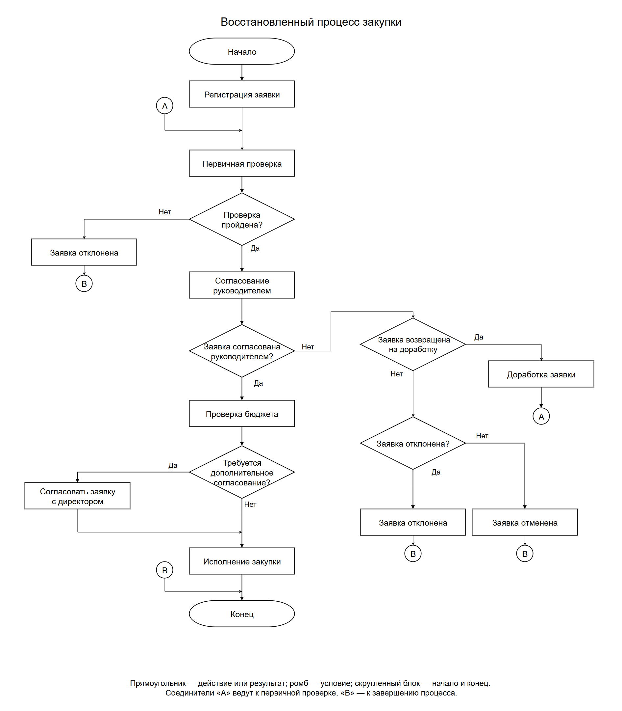

# Кейс 2. Восстановление процесса по журналу событий

Ивашков Кирилл Дмитриевич, ИВТб-2302-06-00

## Подготовка и проверка

Проанализированы 6508 событий по 1000 завершённым заявкам одной версии процесса. Использованы Python и pandas. Строки сгруппированы по ProcessInstanceId и отсортированы по числовому EventIndex. Человеческое задание представлено одним закрытием; дополнительные технические события для него не создавались.

Дубликатов EventId и пары ProcessInstanceId–EventIndex нет. Индексы каждой истории идут подряд с 1, время не убывает. У каждого экземпляра одно начало и одно завершение. TaskId закрытых заданий уникальны. Для каждой ActivityId наблюдается одно название, для каждого названия — один ActivityId. Повторы активности с новым TaskId сохранены.

Для каждой истории построена полная последовательность названий, затем посчитаны одинаковые варианты и непосредственно следующие пары действий. Получены **10 активностей, 12 направленных переходов и 8 полных вариантов**. Сумма частот переходов — 5508, что равно 6508 событиям минус 1000 историй.

## Восстановленная схема



Прямоугольники — действия или результаты, ромбы — условия, скруглённые блоки — начало и конец. Соединители «А» ведут к первичной проверке после доработки, «B» — к общему завершению процесса. Отказ и отмена показаны отдельными результатами; переход к общему блоку «Конец» не объединяет эти исходы. Успешная ветвь завершается после исполнения закупки и соответствует событию «Заявка выполнена» в журнале.

## Основной маршрут, альтернативы и обязательность

Самый частый маршрут: **Регистрация заявки → Первичная проверка → Согласование руководителем → Проверка бюджета → Исполнение закупки → Заявка выполнена**. Так проходят 567 заявок, или 56,7% всего журнала.

Начало всегда одно — «Регистрация заявки». Затем во всех 1000 случаях выполняется первичная проверка. Она либо направляет заявку руководителю, либо заканчивает её отказом. Первичная проверка выполнена 1174 раза: 1000 первых проходов и 174 повторных после доработки.

Руководитель встречается в 955 заявках; у 45 отказ происходит раньше. После руководителя наблюдаются четыре исхода: accept ведёт к бюджету, return — на доработку, reject — к отказу, cancel — к отмене. Отказ и отмена имеют разные названия и Result, поэтому это разные конечные состояния.

Проверка бюджета и исполнение встречаются во всех 911 выполненных заявках и ни в одной отклонённой или отменённой. Эти этапы обязательны для успешных историй, но не для всех заявок. Дополнительное согласование появляется в 209 успешных историях (22,94% от 911), всегда после бюджета и до исполнения. Оно необязательно для успешного класса в целом. Его выполняет director; бюджет — finance, исполнение — procurement. Остальные человеческие роли: specialist, manager и requester на доработке.

Окончания: 911 выполнений (91,1%), 63 отказа (6,3%) и 26 отмен (2,6%). Из 63 отказов 45 следуют после первичной проверки, 18 — после руководителя. Все окончания подтверждены process_completed, поэтому отсутствие поздних этапов в этих историях не объясняется незавершённой выгрузкой.

## Возвраты и варианты

Цикл возврата: **Согласование руководителем → Доработка заявки → Первичная проверка → Согласование руководителем**. У 844 заявок возвратов нет, у 138 один, у 18 два. Возврат затрагивает 156 заявок (15,6%), а всего проходов цикла 174. После доработки нельзя вести стрелку сразу к бюджету: журнал подтверждает повторную проверку и руководителя.

| Вариант | Отличие от прямого маршрута | Число | Доля |
|---|---|---:|---:|
| V01 | Прямой успешный маршрут | 567 | 56.7% |
| V02 | Дополнительное согласование | 188 | 18.8% |
| V03 | Один возврат, затем выполнение | 117 | 11.7% |
| V04 | Отказ на первичной проверке | 45 | 4.5% |
| V05 | Отмена у руководителя | 26 | 2.6% |
| V06 | Один возврат и дополнительное согласование | 21 | 2.1% |
| V07 | Два возврата, затем выполнение | 18 | 1.8% |
| V08 | Отказ у руководителя | 18 | 1.8% |

Варианты охватывают 100% журнала. Полные маршруты с сохранёнными повторами — в [variants.csv](variants.csv); Share хранится числом от 0 до 1.

Примеры исходных историй:

- V01, `00f3e3a0-9d7d-5eac-98a9-b605b6893e61`: прямой успешный маршрут из шести событий.
- V02, `01ae1813-1d99-5524-8f81-77ad5452c33e`: после бюджета присутствует дополнительное согласование.
- V07, `009608ae-1567-584a-b67a-c7ec60ec587d`: руководитель дважды возвращает заявку; проверка и согласование выполняются по три раза, доработка — дважды, затем бюджет и исполнение.
- V04, `08a60c66-22dd-5cf8-90dd-71ba3d53f349`: регистрация → первичная проверка → заявка отклонена.
- V05, `00e3854b-efb6-59c7-ac6a-c85643843db1`: регистрация → первичная проверка → руководитель → заявка отменена.

## Дополнительный анализ и ограничения модели

Среди успешных заявок максимальная сумма без дополнительного согласования — 149 743,41, минимальная с ним — 150 614,59. Правило «сумма > 150 000» разделяет все 911 успешных историй без исключений. Это подтверждает гипотезу о согласовании крупных закупок. Однако точный порог и знак сравнения не идентифицируются: в промежутке нет наблюдений, а неуспешные заявки могут вообще не доходить до этой развилки. Поэтому число 150 000 не выдано за восстановленное условие системы.

Граф непосредственно следующих действий построен автоматически и сопоставлен со схемой: все 12 пар совпадают. Каждая из 1000 историй проходит по его рёбрам. Такой граф допускает больше поведения, чем наблюдается: например, три возврата, отказ после доработки или дополнительное согласование после двух возвратов. Ни одного такого полного маршрута в журнале нет. Рёбра и восемь полных вариантов нужно рассматривать вместе; сами рёбра не доказывают допустимость любой их комбинации. Дополнительное согласование после двух возвратов не наблюдалось, но запрет на такую комбинацию из данных тоже не следует.

Граф не восстанавливает скрытые шлюзы и условия, не доказывает отсутствие параллельных ветвей. Отсутствие наблюдения не равно запрету. Результаты ограничены одной версией и предоставленной выборкой. Интервалы между закрытиями включают очередь и нерабочее время; они не использованы как точное время работы сотрудников. Редкие маршруты не названы аномалиями.

## Воспроизведение и использование AI

```bash
python -m pip install -r requirements.txt
python analyze.py --input "../2кейс/students.csv" --output .
```

Скрипт создаёт таблицы вариантов, переходов, частот и analysis_summary.json. Проверяются уникальность идентификаторов, начала и окончания, сумма 1000 случаев, сумма долей 1 и число пар 5508.
